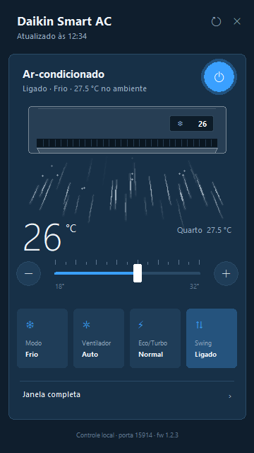
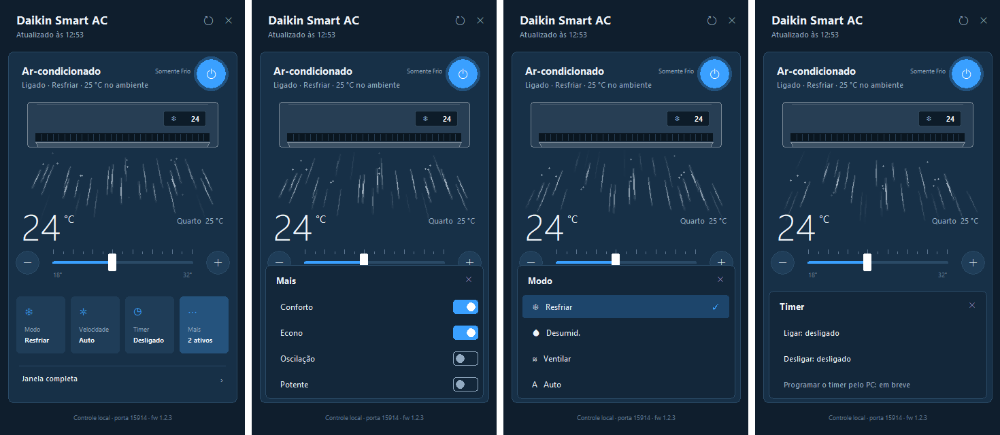
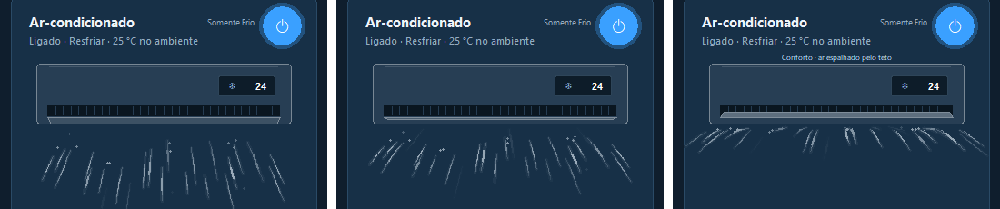

# Daikin Smart AC no PC (Windows)

Controle o ar-condicionado **Daikin Smart AC (Brasil)** pelo Windows, pela rede local,
sem passar pela nuvem: ícone ao lado do relógio, painel animado, menu rápido e janela completa.

<p align="center">
  
</p>

> ⚠️ Projeto **não oficial**, feito por usuários. Não tem ligação com a Daikin.
> Use por sua conta e risco.

## ⚡ Instalação em 1 minuto

1. **Baixe** o [`DaikinSmartAC.exe`](https://github.com/lucas24134/daikin-smart-ac-pc/releases/latest/download/DaikinSmartAC.exe)
   (não precisa instalar Python nem nada).
2. **Abra** o arquivo. Se o Windows mostrar "O Windows protegeu o computador",
   clique em **Mais informações → Executar assim mesmo** (o app não é assinado digitalmente).
3. No assistente que abrir:
   1. **Criar atalho** na Área de Trabalho;
   2. **Buscar IP** — acha o ar sozinho na rede (mesmo se o roteador bloquear a descoberta,
      ele procura o aparelho na porta 15914);
   3. **Device Key** — no app do celular: *Menu → Integrações → Home Assistant →
      escolha o ar → Enviar*. Cole a chave e clique em **Testar e salvar**.
4. Pronto: o ícone do ar aparece ao lado do relógio. Clique nele para abrir o painel.

> O PC precisa estar no **mesmo Wi-Fi** do ar-condicionado.

## Funções

- **Ícone na bandeja** (ao lado do relógio): mostra a temperatura e o estado; clique para abrir o painel.
- **Painel** com animação do aparelho (aleta abre, vento sai), temperatura com slider e −/+.
- **Modo:** Resfriar, Desumid., Ventilar, Auto (e Aquecer, se o aparelho tiver — ar "Somente Frio" esconde).
- **Velocidade:** Silencioso, Baixa, Baixa-Média, Média, Média-Alta, Alta, Auto.
- **Mais:** Conforto (fluxo Coanda — aleta para cima, ar espalhado), Econo, Oscilação, Potente,
  com as mesmas regras do app oficial (Econo × Potente, Conforto × Potente, Conforto × Oscilação).
- **Menu rápido** no botão direito do ícone e **janela completa**.
- Pode **iniciar junto com o Windows** e virar um **`.exe`** que não precisa de Python.
- Timer: por enquanto só mostra o estado (programar pelo PC ainda não foi implementado).




## Como usar

### Opção 1 — `.exe` pronto (recomendado)

Veja **Instalação em 1 minuto** acima, ou baixe em
[Releases](https://github.com/lucas24134/daikin-smart-ac-pc/releases).

### Opção 2 — com Python (Windows 10/11)

1. Baixe o projeto (**Code → Download ZIP**) e descompacte.
2. Dê duplo clique em **`INSTALAR.bat`** — ele instala o Python se precisar e abre o
   assistente de 3 etapas:
   1. **Instalar** componentes e criar o atalho na Área de Trabalho;
   2. **Buscar o IP** do ar na rede (ou digitar);
   3. **Device Key**: no app do celular, *Menu → Integrações → Home Assistant →
      escolha o ar → Enviar*; cole a chave e clique em *Testar e salvar*.
3. Clique em **Concluir**: o ícone aparece ao lado do relógio.

### Gerar o `.exe` você mesmo

Depois da opção 2, dê duplo clique em **`CRIAR_EXE.bat`**. Ele gera o `DaikinSmartAC.exe`,
que funciona sozinho (sem Python) e pode ser enviado para outras pessoas.

### Linha de comando

```bash
python daikin_ac.py status
python daikin_ac.py ligar
python daikin_ac.py modo frio
python daikin_ac.py temp 23
python daikin_ac.py ventilador medio
python daikin_ac.py conforto on
python daikin_ac.py preset eco
python daikin_ac.py bruto
```

## Requisitos

- Windows 10 ou 11, no **mesmo Wi-Fi** do ar-condicionado.
- Aparelho compatível com o app **Daikin Smart AC** (Brasil).
- Porta **15914** liberada na rede local.

## Como funciona

O ar aceita comandos locais por HTTP na porta 15914, com a mensagem criptografada
(AES) usando a *Device Key*. A comunicação usa a biblioteca
[`pyiotdevice`](https://github.com/daikin-br/pyiotdevice) — a mesma da
[integração oficial da Daikin Brasil para Home Assistant](https://github.com/daikin-br/ha-custom-integration).

## Privacidade

A *Device Key* e o IP ficam só no seu PC (`config.json`, ou
`%APPDATA%\DaikinSmartAC\config.json` no `.exe`). **Nunca publique o seu `config.json`.**

## Arquivos

| Arquivo | O que é |
|---|---|
| `INSTALAR.bat` | instala tudo e abre o assistente |
| `ABRIR.bat` | abre o ícone + painel (sem janela de cmd) |
| `CRIAR_EXE.bat` | gera o `DaikinSmartAC.exe` |
| `daikin_ac.py` | cliente do ar + linha de comando |
| `painel.py` | painel animado |
| `app_bandeja.py` | ícone na bandeja + menu |
| `app_assistente.py` | assistente de configuração |
| `app_janela.py` | janela completa |
| `app.py` | ponto de entrada do `.exe` |
| `*.pyw` | atalhos para abrir sem console |
| `gerar_icone.py` | gera o ícone do app |
